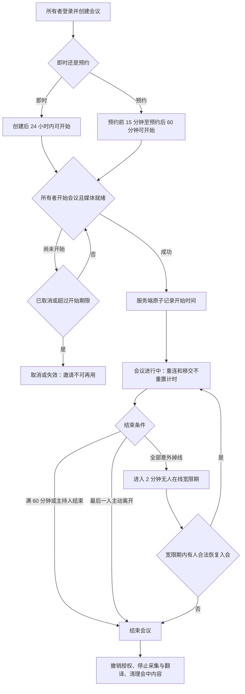
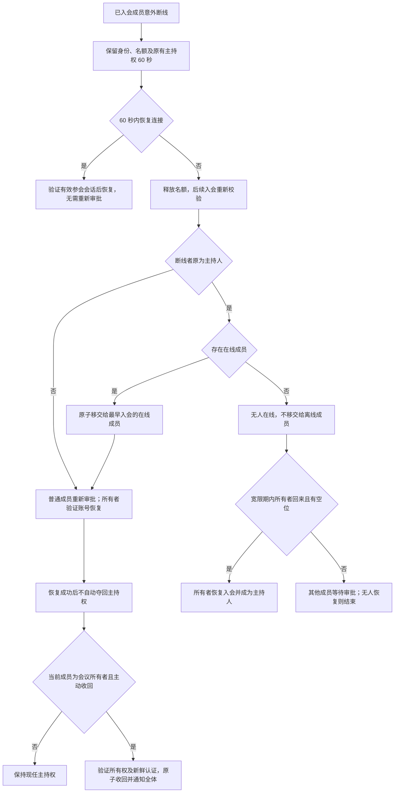
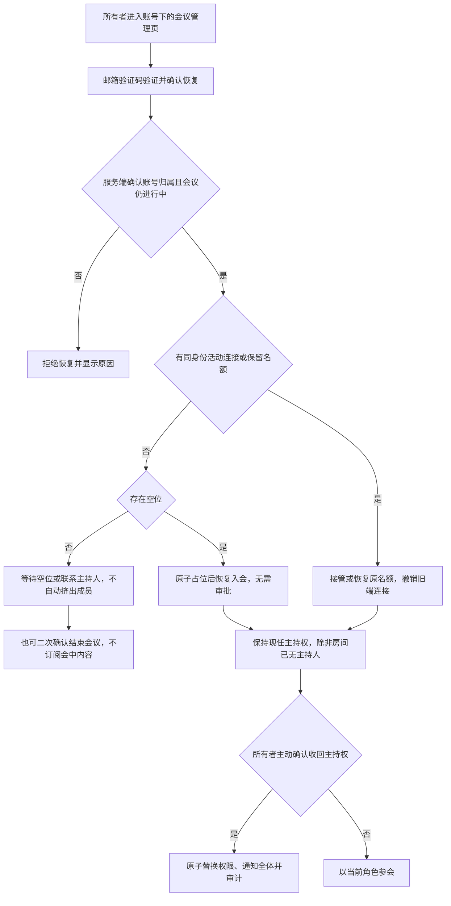
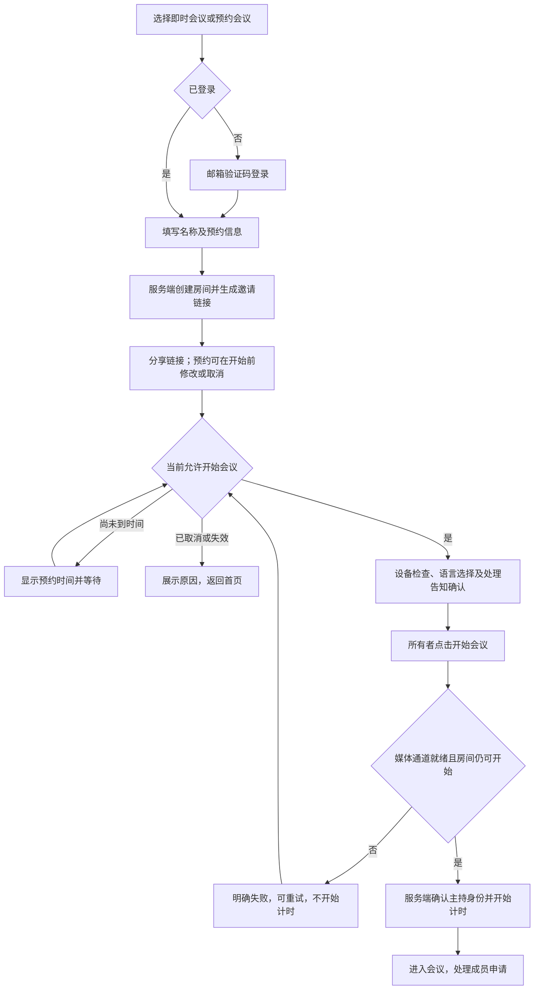
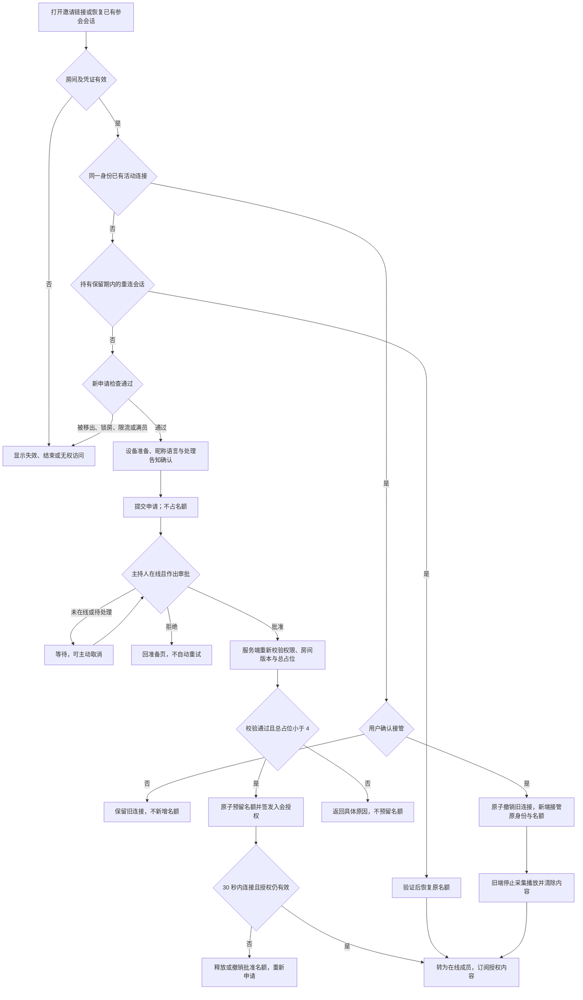
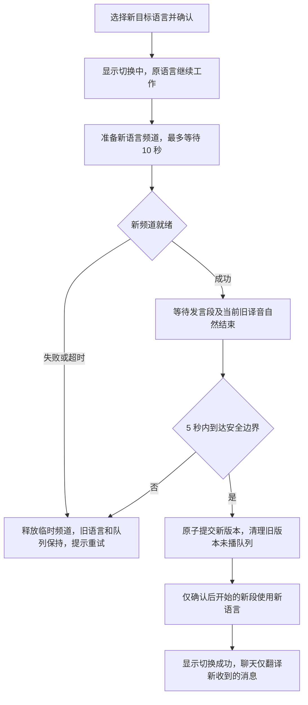
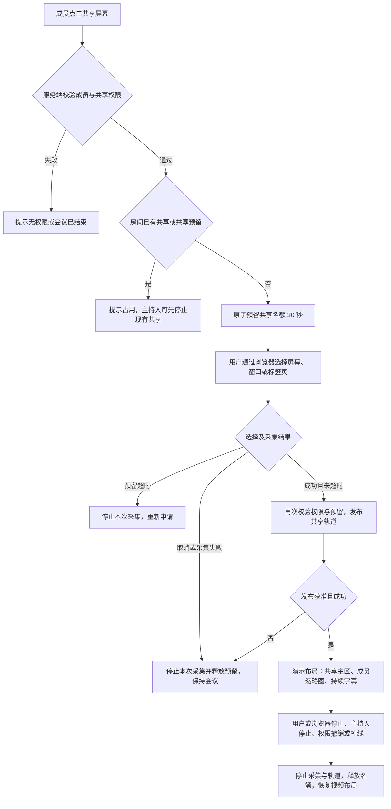
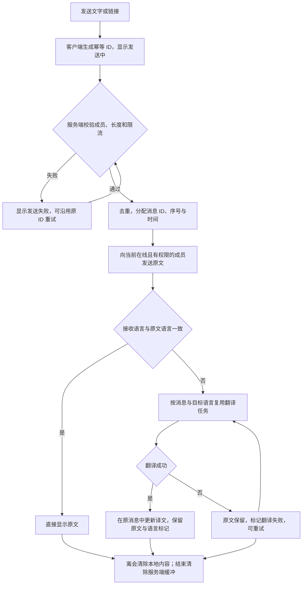
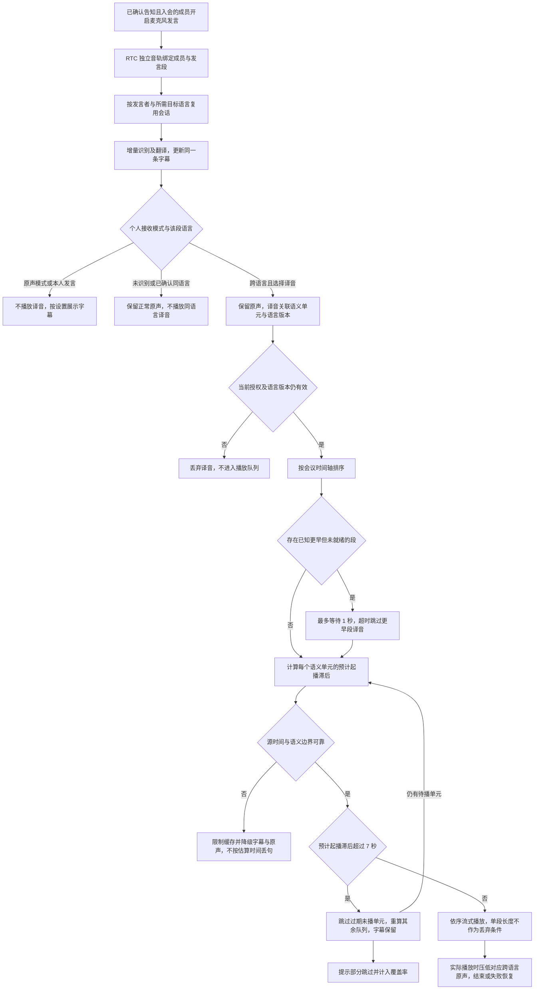
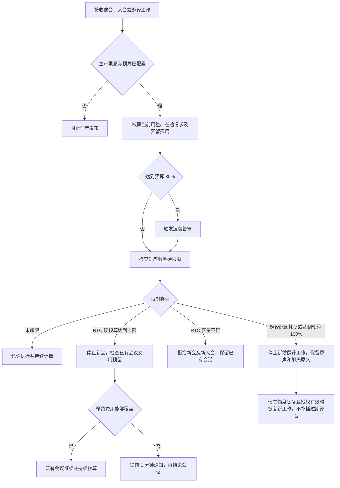

# 实时多语言转换会议室 · V1 产品设计

- 文档日期：2026-10-29
- 修订日期：2026-10-30
- 文档状态：V1 方案，供产品评审与研发拆解
- 产品形态：桌面浏览器视频会议 Web 应用
- 核心模型：`qwen3.8-livetranslate-flash-realtime`
- 核心目标：让使用不同语言的参会者进入同一个房间，用自己的语言发言，通过字幕和译音理解对方。

## 1. 用户与核心场景

面向需要跨语言沟通的远程团队、小型商务交流和项目协作会议。V1 优先解决 2～10 人、轮流发言的跨语言视频沟通。

典型场景：一名中国用户创建房间，邀请英语和日语用户；各自选择目标语言，使用自己的语言发言，其他人阅读对应译文或收听译音。

成功的核心闭环：登录并创建即时或预约会议 → 分享链接 → 检查设备并选择语言 → 审批加入 → 音视频、共享屏幕与跨语言沟通 → 离开或结束会议。V1 定位为可日常使用的小型标准会议产品，人数和时长保持首发限制。

## 2. 同类产品调研与取舍

以下为 2026-10-29 联网访问官方页面获得的信息。仅参考公开功能与交互，不以其宣传作为本产品的性能保证。

| 产品 | 官方公开能力 | V1 借鉴 | V1 取舍 |
| --- | --- | --- | --- |
| Google Meet | 翻译字幕、源语言与目标语言设置、字幕语言切换、会中字幕回看 | 将语言选择和字幕开关放在会中可直接触达的位置 | 本产品源语言由模型自动识别；只回看本次入会后且已接收的字幕 |
| Microsoft Teams Premium | 实时翻译字幕与转录，帮助不同语言用户参与同一会议 | 字幕与视频并存、清晰的发言人归属 | 不做会后转录、智能纪要和任务提取 |
| Wordly | 通过链接或二维码进入，个人选择语言，以文本或音频接收翻译，支持术语表 | 链接入会、个人语言偏好、字幕与译音双模式 | 仅链接邀请；术语表和大型活动模式后置 |

产品定位：把小型视频会议与个人语言频道整合在同一页面，优先保证“进得来、听得见、看得懂”。

## 3. V1 范围与边界

### 3.1 必须实现

| 功能 | V1 定义 |
| --- | --- |
| 账号与会议归属 | 创建者使用邮箱验证码登录；支持退出、跨设备登录和账号删除；访客免注册入会 |
| 创建与邀请 | 即时或预约会议，复制邀请链接；每房间最多 10 人，含主持人，单场最长 60 分钟 |
| 加入前准备 | 昵称、摄像头预览、麦克风输入检测、设备选择、目标语言、接收模式 |
| 基础会议 | 实时音视频、开关麦克风与摄像头、参与者列表、当前发言提示、屏幕共享 |
| 会议聊天 | 全体文字和链接消息，按个人目标语言翻译并保留原文；不做私聊或附件 |
| 翻译字幕 | 原文识别、个人目标语言译文、发言人和时间标识、会中滚动回看 |
| 翻译收听 | 按个人目标语言播放译音；支持原声模式和翻译收听模式 |
| 个人设置 | 会中切换目标语言、纠正自己的发言语言、字幕字号与位置、原文显示、原声与译音音量 |
| 房间管理 | 审批加入、单人或全体静音、控制自行解除静音与共享权限、移出成员、锁定房间、撤销邀请链接、移交主持人、结束会议 |
| 故障恢复 | 设备异常提示、音视频重连、翻译降级、明确的失败状态 |
| 运营保护 | 用户与房间限流、RTC 与模型配额监控、费用预算和超限降级 |

V1 首发目标语言限定为中文普通话、英语、日语、韩语。其模型支持情况沿用原调研，正式发布前重新核验。默认界面语言为简体中文，不与目标语言联动。发言语言默认自动识别，误识别时可手动纠正自己的源语言；优先验证上述语言间的跨语言方向，不将全部模型语言作为首发承诺。

### 3.2 暂不实现

- 周期会议、日历同步、企业组织、SSO、付费套餐和订阅。
- 文件传输、白板、举手、私聊、共享系统音频、远程控制与分组讨论。
- 会议录制、会后字幕导出、回放、智能总结和待办提取。
- 声音复刻、自定义音色、用户维护的术语表、图像辅助翻译。
- 原生移动端和移动浏览器适配；V1 验证桌面 Chrome、Edge 当前稳定版。
- 大型会议和多人同时发言的高质量翻译保证。

10 人与 60 分钟是本产品的首发范围约束，不是模型官方限制。

## 4. 角色与权限

| 操作 | 主持人 | 参会者 |
| --- | --- | --- |
| 分享邀请链接 | 可以 | 可以，入会仍需审批 |
| 审批或拒绝加入 | 可以 | 不可以 |
| 修改自己的语言、字幕、设备 | 可以 | 可以 |
| 控制自己的麦克风与摄像头 | 可以 | 可以 |
| 静音其他成员 | 可以；不能替对方开启麦克风 | 不可以 |
| 移出其他成员 | 可以，但不能移出会议所有者 | 不可以 |
| 全体静音、控制成员自行解除静音 | 可以；不影响主持人本人 | 不可以 |
| 共享屏幕 | 可以；单个房间仅允许一人共享 | 主持人允许时可以 |
| 停止他人共享、设置共享权限 | 可以 | 不可以 |
| 锁定房间、撤销邀请链接 | 可以 | 不可以 |
| 发送聊天与切换消息显示语言 | 可以 | 可以；只能发送全体消息 |
| 修改或取消预约 | 仅会议所有者可以，且会议未开始 | 不可以 |
| 离开会议 | 可以，需选择离开或结束所有人会议 | 可以 |
| 结束所有人的会议 | 可以 | 普通参会者不可以；会议所有者经账号验证可在独立管理页结束 |

会议创建者为会议所有者，必须登录；会议开始时成为主持人。所有权与会中主持权分开：移交主持权不转移账号下的会议归属。权限绑定服务端会话，不放入邀请链接。所有者跨设备登录后可以管理自己的会议，并通过账号验证恢复入会或主动收回主持权；不依赖现任主持人审批，不因重新登录而自动夺回主持权。恢复仍遵守人数上限与房间结束状态。

访客通过昵称、浏览器匿名身份和审批入会；已登录参会者按账号识别。刷新可恢复有效参会身份。被移出者在本场内禁止再次申请；访客更换浏览器仍可能绕过身份限制，通过锁房、链接轮换与申请限流降低风险，不宣称彻底防绕过。

主持人主动离开时须将主持权移交给在线成员，或结束会议。意外掉线时保留主持权至重连保留期结束；之后转交给入会最早的在线成员，入会时间相同按服务端成员 ID 排序。原主持人回来不自动夺回权限。没有在线成员时不向离线成员移交。最后一人主动离开立即结束；全部意外掉线则进入无人在线宽限期，详见下表。

### 4.1 会议生命周期与入会一致性

| 项目 | 确定规则 |
| --- | --- |
| 未开始 | 创建房间不计会中时长；所有者在准备页点击“开始会议”且媒体通道就绪后，由服务端原子记录开始时间，开始计时；访客等待不计时。 |
| 即时链接有效期 | 创建后 24 小时内可开始；未开始且超期则失效。 |
| 预约 | 填写会议名、开始时间和时区，按 UTC 存储；最长提前 30 天预约，可提前 15 分钟开始，开始时间后 60 分钟仍未开始则失效；预约开始时间不是自动开会时间。 |
| 预约管理 | 所有者可在未开始时修改或取消；修改后原链接保留并展示新时间，取消后旧链接失效；每次预约仅启动一场会议，不复用已结束房间。 |
| 会中计时 | 以首次成功开始的服务端时间为准；主持人转移、刷新、断线、语言切换均不重置，满 60 分钟结束。 |
| 重连占位 | 已入会成员意外断线保留身份及名额 60 秒，期间恢复不重复审批；超时释放名额，普通成员再入会重新审批，所有者走账号恢复流程。 |
| 无人在线 | 全部意外掉线后保留房间 2 分钟；成员超出重连保留期回来时，所有者可在有空位时先恢复入会并成为主持人，其他人等待审批；无人恢复则结束。 |
| 容量口径 | 在线成员、断线保留名额和已批准待连接名额合计最多 10 个；待审批申请不占位。批准后 30 秒内未连接则释放名额并撤销本次批准。 |
| 重复入会 | 同一账号或同一访客身份在同一房间只允许一个活动连接；新标签页或设备提示“已在其他窗口参会”，用户确认接管后服务端原子撤销旧连接，旧端停止采集、共享和播放并清除本地内容，不增加名额。 |
| 审批竞争 | 服务端串行裁决容量、审批、锁房、移出及主持权变更；每个命令校验当前权限和状态版本，重复命令幂等，客户端不得以本地人数判定成功。 |
| 房间结束 | 结束操作优先于其他变更，撤销媒体与翻译授权、拒绝后续审批和重连；结束房间不能重新开始，只能新建。 |

以上时限、人数和容量均为本产品首发策略，不是行业统一标准。通过弱网、迟到、后台挂起和集中审批场景验证后才能发布；调整时同步正文、流程图与验收配置，不改动正在进行会议的时长承诺。

#### 会议生命周期流程图

### 4.2 安全与主持控制

| 操作 | 确定规则 |
| --- | --- |
| 锁定会议 | 阻止新申请并清空待审批申请，撤销已批准但未连接的名额；已入会成员保留期内可重连，原活动身份接管可继续。经过账号验证的所有者恢复不受锁房阻挡，仍受容量约束。解锁后其他人可重新申请。 |
| 撤销邀请链接 | 生成新邀请凭证，旧链接立即不能申请或查询房间；取消旧链接产生的待审批及未连接批准；在线成员与有效重连会话不受影响。 |
| 申请限流 | 同一身份与房间每 30 秒最多申请一次；拒绝后需用户手动重试；结合 IP、房间和全局限流防止匿名切换身份刷申请。 |
| 全体静音 | 默认保留成员自行解除静音能力；主持人可关闭该权限，此时除主持人外均保持静音，新入会者同样适用；解禁不自动打开设备。 |
| 共享权限 | 默认允许成员共享，主持人可改为仅主持人；修改立即停止不再有权限者的共享；从不远程强制开启采集。 |
| 主持权移交 | 服务端验证新主持人在线并原子更新权限；未完成的旧主持人命令重新校验，不因发出时曾为主持人就继续执行。 |
| 所有者恢复 | 所有者通过最近 5 分钟内的邮箱验证码验证并主动确认恢复；服务端核验账号、会议归属、房间状态和旧连接，容量允许时无须审批入会。邀请链接不能用于证明所有权。 |
| 所有者收回主持权 | 所有者在线后主动点击“收回主持权”并确认；服务端原子替换主持权、撤销旧权限，通知全体并记录不含内容的审计事件。当前主持人不能移出会议所有者。 |
| 恢复时满员 | 不额外增加名额，不自动踢出现有在线成员；提示等待空位或联系现任主持人协调。所有者可在独立管理页经过上述验证和二次确认结束会议；管理页不订阅媒体或会中内容。 |

#### 断线恢复与主持权流程图

房间结束判定优先于下图中的恢复或移交；无人在线时，同时执行上方生命周期中的宽限期规则。

#### 所有者跨设备恢复流程图

## 5. 页面与信息架构

### 5.1 首页 / 创建房间

- 主要操作：“即时会议”“预约会议”“输入邀请链接加入”；创建前完成邮箱验证码登录，访客加入无需登录。
- 创建字段：会议名称，可选，默认“即时多语言会议”；预约额外填写时间和时区。登录用户可查看未开始会议、编辑预约及取消会议，不提供会后内容列表。
- 创建成功后进入设备准备页，显示邀请链接及复制按钮。
- 提示首发限制：“最多 10 人，最长 60 分钟，支持中英日韩字幕与译音”。

### 5.2 加入前准备页

#### 语言选择的含义与界面文案

每位参会者只选择一种翻译后的目标语言，不需要多选或勾选对方的发言语言。系统分别识别其他成员的独立音轨，按本人目标语言提供字幕；选择“字幕＋译音”后，同时提供该语言的译音。同目标语言的发言保留原声，不重复生成译音；本人发言不回放给本人。

| 界面项目 | 确定规则 |
| --- | --- |
| 字段标签 | 将其他人的发言翻译成 |
| 控件 | 单选目标语言；不是来源语言筛选器 |
| 辅助说明 | 自动识别其他人的发言语言，统一提供所选语言的字幕和译音，无需勾选对方的语言。 |
| 字幕＋原声 | 字幕使用目标语言，声音仍为对方原声 |
| 字幕＋译音 | 跨语言发言转换为目标语言译音，存在几秒延迟；同语言保留原声 |
| 语言示例 | 日语 / 韩语 / 英语 → 中文；中文发言保留原声 |
| 多人发言 | 多路源语言分别处理，译音按会议时间轴排序播放，不同时混播；重叠发言提示轮流发言 |
| 设置边界 | 仅改变本人的目标语言，不改变界面语言或其他参会者的偏好；历史字幕不回译 |

- 显示房间名称、房间状态、人数和摄像头预览。
- 必填：昵称、目标语言（界面标签“将其他人的发言翻译成”）；默认目标语言依据浏览器语言匹配，否则为英语。
- 接收模式：默认“字幕＋原声”，可选择“字幕＋译音”；解释译音存在几秒延迟。
- 默认麦克风关闭、摄像头关闭，用户自主开启；支持设备选择和输入音量检测。
- 在设备检测处提供“播放测试音”，验证扬声器并通过用户点击解锁音频播放。
- 提供浏览器兼容检查、RTC 连通性检查和“试听译音”；测试音与译音试听使用预置素材，不上传用户麦克风。检查失败分别给出授权、换设备、检查网络或更换浏览器入口；不把连通性测试作为低延迟保证。扬声器选择不受支持时提示使用系统默认设备。
- 入会前明确提示：“为生成字幕和译音，你的发言将发送至阿里云翻译服务处理；聊天内容也会交由翻译服务处理。本产品不提供录制和会后内容记录。”用户确认后入会；未确认不向模型发送音频或聊天正文。
- 无摄像头权限可音频或旁听入会；无麦克风权限可旁听，之后可以重新授权。
- 非主持人点击“申请加入”，进入等待页；主持人通过后进入会议。

### 5.3 等待加入页

显示“等待主持人允许加入”，允许取消。主持人未在线时提示等待其上线；房间结束或满员时展示具体原因。拒绝后回到准备页，禁止自动循环申请。

### 5.4 会议主页面

| 区域 | 内容 |
| --- | --- |
| 顶栏 | 会议名、已进行时间、连接状态、邀请按钮 |
| 视频与演示区 | 按在线人数自适应：少人数双列，中等人数三列，较多人数四列，最多显示 10 位成员；共享时演示内容为主、成员缩略图横向滚动为辅，持续显示共享者和停止共享入口 |
| 字幕区 | 译文为主、原文可展开；发言者、时间、源语言、目标语言与识别/翻译状态；滚动回看与“回到最新” |
| 底部控制栏 | 麦克风、摄像头、共享屏幕、字幕、收听模式、聊天、参与者、设置、离开 |
| 参与者面板 | 在线、断线保留和等待连接状态；主持人额外看到审批、全体静音、移出、锁房与共享权限 |
| 聊天面板 | 全体消息、原文与翻译、发送状态、未读标识；系统消息与成员消息有明确区别 |
| 个人设置面板 | 目标语言、自己的发言语言（默认自动）、原文显示、字幕字号与位置、设备选择、原声与译音音量 |

面向用户的状态使用“翻译中”“翻译暂不可用”等明确文案，不显示 Token、协议、模型事件等实现信息。

### 5.5 结束页

区分主动离开、主持人结束、被移出、超时结束、预约取消和链接失效。主动离开且房间仍有效时，可重新申请加入；被移出身份在本场内禁止再次申请，访客防绕过边界遵循角色与安全规则。

不提供会后字幕、录音或总结入口。返回首页可重新创建会议。

## 6. 主要用户流程

### 6.1 主持人创建与邀请

1. 登录后选择即时或预约会议，填写名称及对应预约信息。
2. 完成设备准备、语言选择和翻译处理告知确认。
3. 在允许开始的时间范围内点击“开始会议”，媒体通道就绪后由服务端正式计时；创建或预约后即可复制链接邀请他人。
4. 收到入会申请，查看昵称并允许或拒绝；满员时不再接受申请。
5. 会中可静音或移出成员；结束时点击“结束所有人的会议”并二次确认。

#### 创建与开始会议流程图

### 6.2 参会者加入与沟通

1. 打开链接；先检查房间是否有效及是否有空位。
2. 填写昵称，选择目标语言，检查设备，确认翻译处理告知。
3. 申请加入；获批后看到视频、听到原声并接收所选语言字幕。
4. 开启自己的麦克风并发言，其他人按各自语言收到翻译。
5. 需要语音辅助时切换“翻译收听”，也可随时切回原声。
6. 点击离开，仅结束自己的参会；其他人继续。

#### 审批、容量与重复入会流程图

锁房和撤销邀请均撤销相应未连接批准；重连或接管不绕过房间结束、成员移出和会话撤销检查。首次进入仍须完成设备准备与处理告知确认。上图为普通成员路径，已验证所有者使用上方“所有者跨设备恢复流程图”，不进入主持人审批。

### 6.3 切换目标语言

1. 选择新语言并确认，界面显示“正在切换到日语”等状态。
2. 保持原语言字幕和译音正常接收，后台准备新频道；新频道准备期间不向该成员播放新语言内容，也不清空旧队列。
3. 新频道就绪后，在发言段结束且本端当前旧译音自然播放结束的安全边界，服务端与客户端确认新语言版本；原子停止旧版本接收、清空尚未播放的旧队列并启用新频道，仅新版本确认后开始的发言段使用新语言。旧字幕保留语言标记，聊天仅翻译确认后收到的新消息。
4. 新频道准备超过 10 秒或安全边界等待超过 5 秒时，本次切换失败并释放临时频道；继续原语言及旧队列，提示重试，不截断当前语义或影响原始音视频。等待时限为首发参数，纳入实测。

#### 目标语言切换流程图

### 6.4 共享与文字协作

1. 成员点击“共享屏幕”，服务端校验共享权限及当前占用，再由用户在浏览器中选择共享对象；取消或采集失败立即释放预留。
2. 共享建立后切换为演示布局，字幕持续可见；共享者可主动停止，主持人可停止他人共享。
3. 成员打开聊天并发送文字或链接，其他在线成员先收到原文，再按个人语言显示译文；失败可重试，原文不丢失。
4. 离开、被移出、端接管或会议结束时停止屏幕采集并清除本地会中内容。

## 7. 核心交互规则

### 7.1 字幕

- 默认开启，每个人独立控制，关闭不影响其他人。
- 默认以目标语言显示译文，可同时展开原文；自己的发言只显示原文，不播放自己的译音。
- 增量结果随生成更新；原文在识别完成后定稿，译文在对应响应完成后定稿，避免把同一句的每个增量展示成多条消息。
- 使用会议成员身份确定发言人；不能将模型的 `speaker_id` 直接当作会议成员账号。
- 历史范围仅为本次入会期间、已订阅频道并已接收的内容。重连缺失部分标记“此处字幕可能不完整”，不伪造补齐。
- 用户向上查看时停止自动滚动，显示“有新字幕”；点击“回到最新”恢复跟随。
- 不向刚加入的人补发此前内容；无会后历史查询。客户端只保留本次入会字幕，最多覆盖本场 60 分钟。

### 7.2 收听模式

| 模式 | 其他人的原声 | 其他人的译音 | 字幕 |
| --- | --- | --- | --- |
| 原声（默认） | 正常音量 | 不播放 | 默认开启，可关闭 |
| 翻译收听 | 默认正常音量；对应跨语言译音实际播放期间才降至 10%，播放结束或失败即恢复 | 正常音量，可调节；同语言不重复生成 | 默认开启，可关闭 |

- 自己的麦克风上行保持独立，不把播放的原声或译音重新作为模型输入。
- V1 翻译收听采用统一默认音色，不复刻成员声音。
- 自动识别尚未确定语言时保留正常原声，不预先压低或静音；确认同语言后继续原声，不播放同语言译音。跨语言时仅在对应译音真正起播期间压低该发言者原声，避免“先降低原声、后识别语言”导致漏听句首。
- 用户可主动设置原声背景音量，但将等待期间的原声静音时须明确提示“译音生成前将听不到原声”；默认不采用该设置。调低原声、译音开始/结束和故障恢复使用短音量渐变，避免突变。
- 译音不自动混播；统一排序、等待窗口与过期策略见下方“发言段与译音排序”，不按网络到达顺序直接播放。
- 译音失败时恢复原声音量，字幕继续；原声与译音切换作用于本人。

### 7.3 发言与主持控制

- 进入会议默认静音；使用耳机和轮流发言作为轻提示。
- V1 不强制抢麦，允许正常自由交流；多人同时发言时提示“多人正在发言，轮流说话可改善翻译”。
- 主持人静音成员后，只有在允许自行解除静音时，该成员才可自行开启；主持人也不得远程强开设备。
- 主持人结束、移出成员均二次确认；普通个人设置即时生效。

### 7.4 屏幕共享与布局

| 项目 | 确定规则 |
| --- | --- |
| 共享操作 | 用户主动点击后通过浏览器选择屏幕、窗口或标签页；取消选择不影响会议，不共享系统音频，不向翻译模型发送屏幕画面。 |
| 并发与停止 | 同一房间只允许一名共享者，服务端原子预留共享名额，30 秒内未发布则释放，超时选择后须重新申请；取消或采集失败立即释放。其他人提示已有共享，主持人可先停止现有共享。浏览器停止、共享者离开/断线或权限撤销后立即释放，重连不自动恢复屏幕采集。 |
| 布局优先级 | 共享内容优先占主区域，成员缩略图其次；字幕默认固定下方，可选演示区底部叠加。聊天与参与者共用右侧面板，互斥打开；空间不足先收起缩略图，不遮挡字幕和停止共享按钮。 |
| 可读性 | 字幕字号支持小、标准、大；叠加字幕提供高对比背景。支持键盘操作、可见焦点、按钮可访问名称及加载/失败状态，个人布局不改变其他人的界面。 |

#### 屏幕共享流程图

### 7.5 会议聊天

| 项目 | 确定规则 |
| --- | --- |
| 内容与发送 | 仅全体文字和链接，单条最多 2,000 字符；服务端为消息分配 ID、序号和时间，客户端显示发送中、已发送或失败；重试沿用幂等 ID，避免重复。 |
| 消息翻译 | 原文先送达并可立即阅读，按接收者目标语言异步生成译文，同一消息与目标语言复用结果；同语言不重复翻译。失败保留原文并允许重试，不合成聊天译音。 |
| 内容安全 | 按纯文本渲染，不执行 HTML；外链只接受 http/https 并以隔离新页打开；服务端校验长度、成员权限并限流。 |
| 历史与切换 | 只接收本次入会后的消息，不补发入会前或重连缺失内容；切换语言不回译历史，旧消息保留语言标记；离开清除聊天，结束后无查询接口。 |
| 系统消息 | 入会、离开、主持权转移和共享变化使用独立系统消息样式与模板，不作为用户正文送翻译模型。 |

#### 聊天发送与翻译流程图

### 7.6 发言段、语言纠正与译音排序

| 项目 | 确定规则 |
| --- | --- |
| 发言关联 | 网关以成员音轨、发言段 ID 和原始媒体时间绑定字幕与译音；服务端依据映射到会议时间轴的段开始时间排序，同刻按成员 ID，再按成员段序号打破平局，不采用客户端墙上时钟。 |
| 段内一致性 | 同一发言段的目标语言版本、源语言模式和输出模式固定；切换只影响确认后开始的新段。等待安全边界超时则取消本次切换，不强行截断句子；源语言纠正及输出模式变化同样采用先准备、后提交，失败保持旧版本。 |
| 等待与排序 | 每个接收者只维护一条译音播放队列；晚开始的段先到时，为已知较早段最多等待 1 秒。较早段超时则跳过其译音，字幕仍可更新；开始播放后不插入更早的迟到段。 |
| 积压度量 | 以语义单元为队列项，关联其源音频结束时间；预计起播时刻为当前时刻加当前播放剩余时长及排在前方的有效译音时长。“预计起播滞后”是该起播时刻减源单元结束时刻；队列总时长仅用于观测，不作为丢弃条件。 |
| 积压与过期 | 预计起播滞后超过 7 秒时，跳过已过期且尚未播放的语义单元，并重算后续项；不得仅因单段译音长度超过 5 秒而丢弃。正在播放的语义单元不因队列变长而截断；未完成长段按模型可稳定对齐的语义边界流式播放，不等待整段结束。提示“部分译音已跳过，请参考字幕”。 |
| 长句与流式边界 | 网关必须验证源音频时间与输出语义单元的稳定关联；不能把任意音频分片误当作完整语义。未能可靠关联时不按估算时间自动丢句，限制缓存并降级为字幕与原声，标记译音不可用；长句完整性与实时性均须通过验收。 |
| 状态区分 | 每段区分识别中、原文已定稿、翻译中、译文已定稿、译音待播/播放中/失败/跳过；原文识别失败与单独译文失败分别提示，不显示虚假完成状态。 |
| 源语言纠正 | 展示识别出的源语言，用户只能修正自己的源语言，选择范围为首发语言或自动；从新段生效，不修改历史字幕。 |
| 模型边界 | 必须先验证模型是否接受强制源语言以及段边界切换。若不支持，须补齐并验证可强制源语言的识别翻译链路；不能将纯 UI 选择冒充已生效的纠正功能。 |
| 同语言收听 | 未识别及已确认同语言时均保留正常原声，不重复生成同语言译音；错误识别引发播放时立即停止错误译音并恢复原声，明确标记识别纠正，不承诺未收到的历史音频可以恢复。 |

上述数值是首发排队策略，计入端到端延迟验收；不能为提高完整播放率无界等待，也不能只靠丢弃大部分译音制造低延迟结果。

#### 发言翻译与译音播放流程图

原文识别、译文生成或译音生成可分别失败；失败按下一节降级，不将未完成内容标为成功。权限撤销、离会及版本切换会使已排队的旧译音失效。

## 8. 状态、异常与恢复

| 场景 | 用户反馈 | 处理方式 |
| --- | --- | --- |
| 房间不存在、结束、满员 | 展示具体原因 | 不进入设备申请和模型连接流程 |
| 麦克风权限被拒或设备拔出 | 提示设备不可用 | 保持旁听，提供重新选择入口 |
| 浏览器禁止音频自动播放 | “点击开启声音” | 保留视频和字幕，不显示虚假的播放成功状态 |
| 媒体网络断开 | “连接中，正在尝试恢复” | 自动重连；失败 30 秒后提供手动重试和离开 |
| 只有翻译断开或模型限流 | “翻译暂不可用，已切换原声” | 保留会议，后台退避重试；恢复后提示，不回放过期译音 |
| 个别语言频道失败 | 对应语言用户看到故障状态 | 其他语言和原始媒体不受影响 |
| 新语言切换失败 | “切换失败，继续使用原语言” | 保留原设置，不无限加载 |
| 主持人意外掉线 | 展示主持人重连状态 | 60 秒内允许恢复，之后按权限规则移交 |
| 距离时长上限 5 分钟、1 分钟 | 全体显示倒计时提示 | 60 分钟时结束会议；不额外收费续时 |
| 翻译网关不可用 | 明确显示原声会议模式 | 用户可继续原声会议或主动离开 |
| 共享被拒、采集结束或网络中断 | “共享未开始”或“共享已结束” | 释放共享权限，恢复视频布局，不关闭整场会议 |
| 聊天翻译不可用 | 消息显示原文及翻译失败 | 可重试翻译，不阻塞聊天原文送达 |
| 账号登录过期 | 提示重新登录 | 创建和预约管理停止写入；已入会会话按服务端有效期运行，不因刷新页面变为主持人 |
| 房间锁定、旧邀请或被其他端接管 | 展示具体原因 | 不自动重复申请；被接管端立即停止媒体及翻译接收 |

媒体连接与翻译状态分别展示，避免将“原声正常但翻译失败”误报为会议断开。

## 9. Qwen 模型接入约束

本节用于评审与研发，不直接出现在普通用户操作界面。

| 官方能力或约束 | V1 设计决策 |
| --- | --- |
| 60 种源语言、29 种语音输出语言 | 首发仅开放经过验证的中英日韩；按能力表维护语言清单 |
| 音频与图像输入，文本与音频输出 | V1 仅输入音频，不将摄像头视频送模型 |
| 源语言自动识别 | 默认自动；手动源语言纠正必须验证协议能力，不能假设自动识别模型必然支持强制源语言 |
| 单会话通过 `session.translation.language` 指定目标语言 | 不假设单连接能输出全部语言；按发言者独立音轨与目标语言组织翻译会话 |
| 说话人分离支持交替发言 | 优先用 RTC 音轨身份绑定成员；不承诺混音抢话识别质量 |
| 官方称同传时延低至 2.3 秒 | 对用户解释“存在几秒延迟”；上线以实测结果为准 |
| 支持 WebRTC、AOQ、WebSocket | 浏览器与会议媒体采用 WebRTC；服务端翻译网关优先 WebSocket，便于频道复用与路由 |
| 3.8 与 3.5 参数及事件有差异 | 固定按 3.8 协议开发，不能直接沿用旧型号示例 |

### 9.1 能力分工

- **会议前端：** 房间界面、设备授权、个人偏好、字幕渲染、聊天、屏幕共享、原声与译音播放。
- **会议服务与 RTC：** 账号与预约、房间生命周期、权限原子裁决、入会审批、独立媒体音轨、共享轨道、聊天消息及成员状态；RTC 最终选型须在能力验证阶段确定，验证服务端音轨订阅、共享、权限撤销与重连。
- **翻译网关：** 订阅原始音轨，完成音频转换，连接 Qwen，绑定发言者与字幕，路由译音，处理断线和限流。
- **Qwen：** 源语言识别、翻译文本与译音生成，不承担房间管理和视频转发。
- **聊天翻译适配：** 提供独立的文本翻译接口，按消息与目标语言复用结果；在能力验证阶段选定并验证支持中英日韩的文本翻译模型，不假设实时音频模型必然支持纯文本消息输入。其配额、成本和内容处理条款独立核验。

API Key 保留在服务端。字幕、原声和译音带上房间、成员及发言关联标识，防止跨房间或跨发言串流。

### 9.2 频道与用量规则

- 复用单位为“发言者 × 目标语言”，同一结果向多个同语言听众分发，不为每位听众重复生成。
- 只为有需求的目标语言建立会话；没有听众时停止对应生成。仅字幕需求使用文本输出，有译音听众时使用文本与音频输出。
- 输出模式变化若不能安全地在原会话更新，则在发言边界切换连接，并防止重复字幕和重复播放。
- 最多 10 人、首发 4 种语言时，在源语言已确认为首发语言且排除同语言翻译后，每位发言者最多面向另外 3 种目标语言，稳定跨语言组合最多为 30 个；不是 10 条模型连接。源语言未确定、语言切换准备及连接轮换可能产生额外临时会话，必须另外预算与限流，不将 30 当作总连接硬上限。
- 官方页面当前默认列出 10 RPM、100,000 TPM。使用指南说明 RPM 为每分钟建连次数，不等同在线人数上限；集中建连和重连需排队、退避，上线前评估提高配额。
- 保持每条音轨的流式连续性，不采用逐句建连；按静音回收等方式优化前，先验证恢复延迟与上下文影响。
- 不以一次请求的上下文窗口推断可持续开会时间。60 分钟长连接、会话上限与上下文处理须在 PoC 中验证；必要时在发言边界轮换连接，保留会议身份映射。

### 9.3 关键协议校验点

- `session.output_modalities`：仅文本为 `["text"]`，译音模式为 `["text", "audio"]`。
- 原文增量：`conversation.item.input_audio_transcription.delta`；完整原文：`conversation.item.input_audio_transcription.completed`。
- 译文增量：`response.text.delta` 或 `response.audio_transcript.delta`；译音分片：`response.audio.delta`。
- 默认输入 16 kHz PCM、输出 24 kHz PCM；RTC 音轨需要转换为模型要求的格式，不能直接假定兼容。
- 正常结束时发送 `session.finish`，等待 `session.finished` 后关闭；异常断线则标记可能缺失的尾句。

### 9.4 配额、预算与滥用保护

| 项目 | 确定规则 |
| --- | --- |
| 调度 | RTC、语音翻译与聊天翻译分别设置并发、建连和请求限额；重试使用退避与抖动，有次数及总时长上限，权限撤销后不再重试。 |
| 预算配置 | 上线前必须配置单房间预算、每日全局预算、最大同时在线房间数、创建/验证码/聊天接口限流；具体值以 PoC 费用核算确定，缺失则阻止生产发布。 |
| 预算告警 | 达预算 80% 告警，100% 停止对应新增翻译工作并切原声/原文；预算计算包含在途请求与预估费用，不承诺账单零超额。 |
| 服务保护 | 模型额度耗尽保留原声会议及聊天原文；RTC 容量不足拒绝新会与新入会并保留既有会话。RTC 硬预算达到上限后停止新会，既有会议在预留费用覆盖范围内继续；无法覆盖时提前 1 分钟通知后结束。 |
| 观测 | 分别记录音视频、共享、语音翻译、聊天翻译的成功率、延迟、丢弃和费用；告警不采集内容正文。 |

模型能力、配额、协议事件与长连接规则沿用原调研而非本次重新验证的事实；RTC、文本翻译选型和源语言纠正能力未完成验证前，不进入正式发布。

#### 配额与预算降级流程图

### 9.5 商务术语与文本翻译上线门槛

| 项目 | 确定规则 |
| --- | --- |
| 首发术语范围 | 维护不含真实客户信息的内部测试词表，覆盖人名、公司名、产品名、行业术语、金额、日期和否定句；按首发语言方向逐项验证语音与聊天翻译。用户自定义术语表继续后置。 |
| 术语失败处理 | 记录漏译、专名误译、金额和否定含义改变等问题；不能用普通闲聊语料通过率掩盖商务关键错误。金额、日期及否定句测试集不允许出现改变核心含义的未解决错误。 |
| 词表能力边界 | 测试词表不是运行时模型术语表；只有官方协议明确支持且已验证时才注入术语，不通过事后字符串替换强行修正音频或金额。 |
| 文本翻译选型 | 在进入协作功能研发排期前，确定具体模型、区域、调用协议、版本与服务配置；完成首发语言、同语言识别、术语、长消息、延迟、成本、限流和处理条款验证。未完成时不得将聊天翻译标为已就绪。 |
| 一致性 | 聊天原文送达与翻译独立；文本翻译不可用时仍保留聊天原文。对外语言清单、入会告知、预算和验收随实际选型同步更新。 |

## 10. 数据与基本保护

- 分享链接使用不可预测的房间标识；普通成员获主持人批准，或所有者通过账号恢复验证后，才能按权限订阅或发布媒体；服务端校验每次访问，独立管理页不获取会中内容。
- 仅在完成入会告知、正式加入且麦克风开启后上传发言音频；准备页预览不送模型。
- V1 不持久保存录音、视频、共享画面、字幕或聊天正文及译文；内容只在本次客户端会话与服务端必要内存缓冲中存在，离会清除本地内容，房间结束清除服务端缓冲，不提供历史内容查询。
- 账号保存必要的邮箱与认证信息；预约元数据保留至取消、失效或会议结束后最多 24 小时，与会中内容分开管理。删除账号时撤销登录会话、取消未开始预约；正在进行的会议先移交主持权或结束后再完成删除。
- 房间配置、权限及恢复所需状态最多保留至会议结束、取消或失效后 24 小时，再删除；运行指标可保留不含内容的聚合数据。
- 日志只记录状态、错误码、用量和耗时，不写入原始音频、字幕内容、邀请凭证或 API Key。
- 上述是本产品的数据策略，不代表云服务商不留存数据；上线前核验百炼与 RTC 的处理地域和数据条款，使入会告知与实际一致。

## 11. 验收标准与上线门槛

以下为本产品的验证目标，并非模型官方服务承诺。每次测试记录网络、浏览器、语言方向与并发条件。

| 项目 | V1 验收要求 |
| --- | --- |
| 主流程 | 10 人完成创建、审批加入、跨语言沟通、个人离开及主持人结束；权限无越界 |
| 音视频 | 10 人、60 分钟持续会议可用；翻译服务故障不主动中断 RTC |
| 语言覆盖 | 中英日韩 12 个跨语言方向分别验证字幕和译音；自己的译音不回放 |
| 字幕归属 | 单人轮流发言时昵称映射正确，无跨房间内容；增量不重复追加为多句 |
| 延迟 | 良好网络、轮流发言下，以可对齐语义单元的原声结束至对应首个可理解译音播放计算，目标 P50 ≤ 4 秒、P95 ≤ 7 秒；分语言方向记录 |
| 译音覆盖 | 同一验收条件下，每个跨语言方向中，已确认有效且应生成译音的语义单元至少 95% 完整播放；同时记录发言段起播率，避免长段只播开头也算成功。超时、生成失败、切换及排队丢弃分别记录，主动关闭译音或退会后的单元不计入应播放范围。 |
| 翻译质量 | 每方向至少 30 条预先审定的常见会议语料，由懂双语人员评估；至少 90% 无改变核心意思的错误，数字、日期和否定句单列问题 |
| 语言切换 | 准备期间原语言正常工作；提交后新发言使用新语言，不补译历史；失败时旧频道及队列不中断，连续发言不强制截断；成功后无旧译音残留 |
| 重叠发言 | 有明确提示，不无限堆积译音；允许翻译质量下降但不允许页面或音频管线阻塞 |
| 异常与恢复 | 权限拒绝、设备拔出、媒体断线、模型断线、限流、主持人掉线均按既定规则处理 |
| 用量与配额 | 验证最多 30 个稳定跨语言组合及临时会话的建连调度、实际 Token 用量与服务配额，不发生无界自动重连 |
| 数据 | 离会清除本地字幕；无会后查询入口；日志抽检无音频、字幕正文和密钥 |
| 身份与预约 | 所有者跨设备管理预约；访客免注册审批加入；预约早到、迟到、修改、取消、失效与账号删除符合规则 |
| 容量与竞态 | 并发批准、重连、重复接管和主持权变更不超员、不越权；断线保留与等待连接超时正确释放 |
| 屏幕共享 | 选择/取消、竞争共享、浏览器停止、主持人停止、权限撤销及共享者掉线均可恢复布局；无越权轨道订阅 |
| 聊天 | 原文与翻译归属正确，失败不丢原文；重试不重复、顺序稳定；无脚本执行，不补发入会前内容，离会清除 |
| 主持控制 | 全体静音、禁止自行解除静音、锁房、链接撤销和主持权移交均由服务端生效，旧权限和旧邀请无法绕过 |
| 所有者恢复 | 跨设备新鲜认证后无需主持人审批；收回主持权需主动确认并通知全体；锁房不阻断合法恢复，满员不超员、不自动踢人，旧端失权，普通成员无法冒充所有者 |
| 原声衔接 | 自动识别延迟和同语言发言下句首原声完整可听；只有跨语言译音实际播放时压低对应原声，结束、识别纠正或失败及时恢复，不输出自身回声 |
| 长句与排队 | 长译音不因总时长被误丢；按源语义时间验证起播滞后、乱序与过期；正在播放的语义单元不中途截断；无法稳定对齐时明确降级，不伪造时间标签 |
| 商务与聊天选型 | 内部术语测试覆盖语音及聊天；关键金额、日期与否定句错误解决；文本翻译模型、配置、费用及数据条款在协作研发前完成验证 |
| 翻译连续性 | 段边界切换无串语言、重复播放或旧队列残留；验证迟到、乱序、等待超时与积压丢弃，并分别统计语义单元完整播放率及发言段起播率 |
| 识别纠正 | 通过误识别样本验证手动源语言真正改变后续处理；若模型不支持则配套链路必须先验证通过 |
| 可读性与设备 | 共享时字幕可读，字号和位置生效；键盘可完成核心操作；预检失败有明确恢复入口，不支持扬声器切换时可使用系统默认 |
| 费用与保护 | 配额和预算配置完整；模拟模型与 RTC 超限，告警、停止新增、在途费用预留和降级均可验证 |

翻译质量和延迟未达到门槛时，先缩小语言或并发范围，再决定发布并同步对外承诺；不得直接沿用宣传指标作为验收结果。语言切换、识别失败和队列过期导致的跳过段必须独立计数，延迟统计不得悄悄排除失败段。

### 11.1 首次试用观测指标

- 入会成功率：成功进入会议的人次 / 提交入会申请且获批的人次。
- 翻译可用率：有有效发言输入时，翻译正常工作的时长 / 应提供翻译的时长。
- 首条译文与首段译音耗时、各语言方向的延迟分位数。
- 语言切换成功率、自动恢复成功率、译音积压丢弃次数。
- 单房间每小时的 RTC、模型输入、文本输出和音频输出成本，按语言数量分组。
- 共享成功率、聊天原文送达率与翻译成功率、预约入会成功率、译音播放覆盖率和端接管成功率。

## 12. 实施顺序

1. **能力验证：** 在协作研发排期前确定 RTC 和聊天文本翻译选型；双人中英音轨接入 Qwen，验证字幕、译音、源语言纠正、原声衔接、语义时间对齐和时延，再验证日韩方向、长句、内部商务词表、共享轨道与长连接。
2. **会议闭环：** 完成账号、预约、邀请、准备页、审批、媒体、主持控制、状态裁决、重连占位与重复入会接管。
3. **协作与多语言：** 完成屏幕共享、聊天及消息翻译、个人频道复用、段边界语言切换、字幕归属和译音排序。
4. **上线验证：** 完成弱网恢复、并发竞态、限流预算、译音覆盖率、60 分钟压测、数据清理和可访问性，通过验收后发布 V1。

## 13. 参考资料

调研日期：2026-10-29。后续模型协议、语言与价格以官方最新页面为准。

主流流程对照复核日期：2026-10-30。已访问的 Teams 与 Wordly 官方资料支持个人语言选择、字幕与音频输出、等候审批及共享权限等交互。本文人数、预约窗口、重连和播放阈值为产品自定策略，不作为行业标准；Google Meet 页面在本次复核中访问超时，保留为原调研参考，不计入新增核查结论。

1. [Google Meet：使用翻译字幕](https://support.google.com/meet/answer/10964115?hl=en) — 参考语言选择、字幕入口与会中回看。
2. [Microsoft Teams Premium](https://www.microsoft.com/en-us/microsoft-teams/premium) — 参考实时翻译字幕与转录定位。
3. [Wordly 官方产品介绍](https://www.wordly.ai/) — 参考链接入会、个人语言选择、字幕与音频双模式；其规模和准确率宣传不作为本产品指标。
4. [Qwen3.8-LiveTranslate-Flash-Realtime 模型信息](https://help.aliyun.com/zh/model-studio/qwen3-8-livetranslate-flash-realtime) — 核对模型能力、价格、限流和输出模态。
5. [千问实时语音 / 音视频翻译使用指南](https://help.aliyun.com/zh/model-studio/qwen3-5-livetranslate-flash-realtime) — 页面同时介绍 3.8 与 3.5，参考语言表、事件差异、说话人分离和用量换算。
6. [Realtime API 协议概述](https://help.aliyun.com/zh/model-studio/realtime-api-overview) — 参考 WebRTC、WebSocket、AOQ 的适用范围。
7. [Teams：等待室管理](https://learn.microsoft.com/en-us/microsoftteams/who-can-bypass-meeting-lobby) — 复核成员等待、审批与身份差异。
8. [Teams：字幕与转录](https://learn.microsoft.com/en-us/microsoftteams/meeting-transcription-captions) — 复核个人目标语言、发言人归属及实时字幕与持久化转录的区别。
9. [Teams：内容共享](https://learn.microsoft.com/en-us/microsoftteams/meeting-policies-content-sharing) — 复核屏幕、应用共享与权限管理。
10. [Wordly：使用流程](https://www.wordly.ai/translation-software) — 复核链接入会、访客免注册、个人语言、字幕与译音双模式。
11. [Wordly：音频翻译](https://www.wordly.ai/audio-translation) — 复核音频与字幕输出及商务术语能力定位，不引用其宣传作为本产品性能保证。
