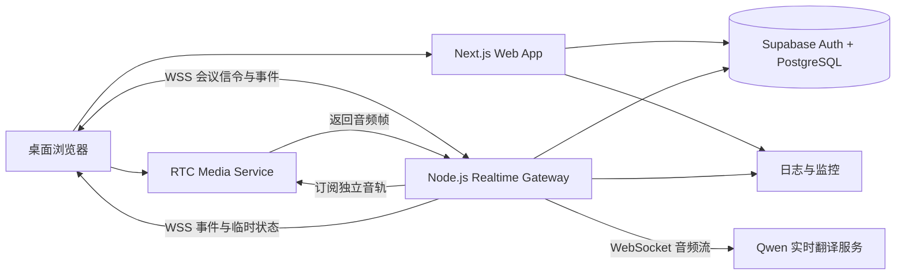
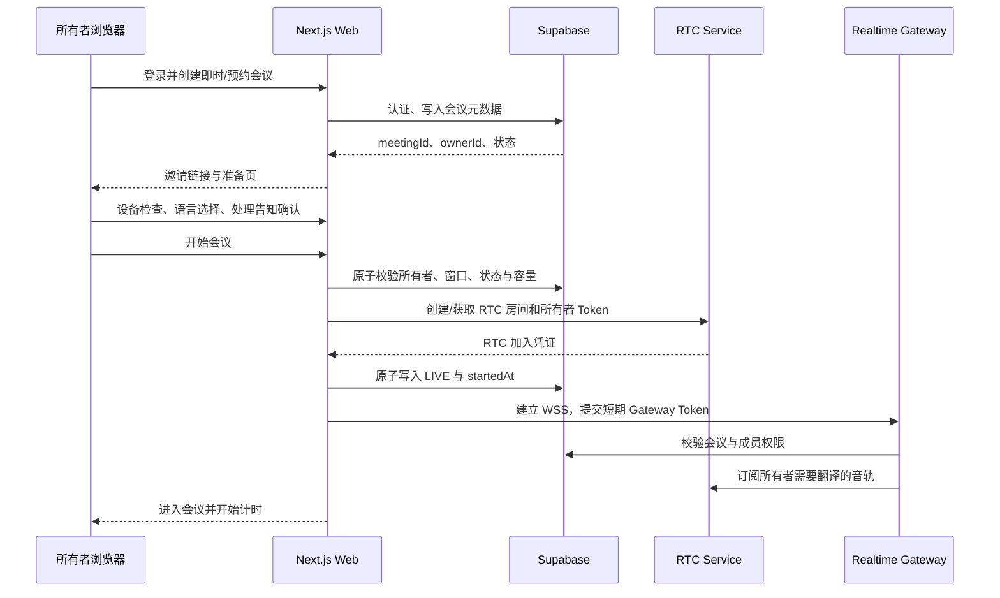
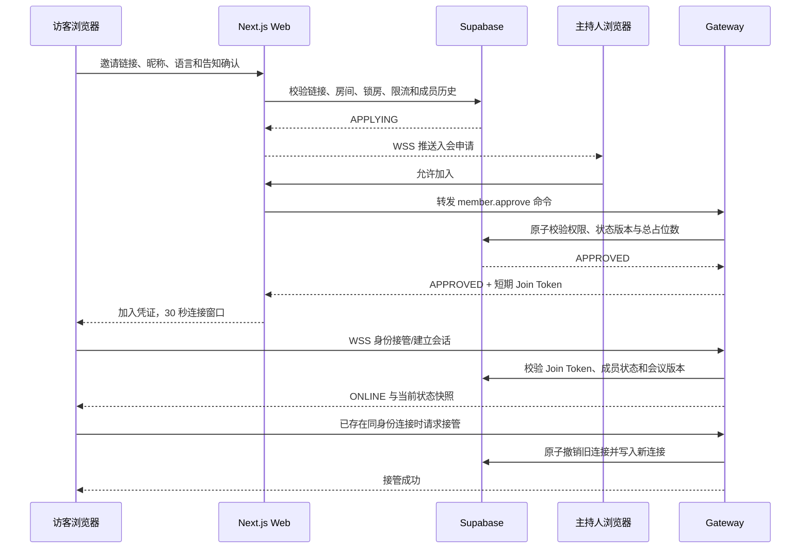
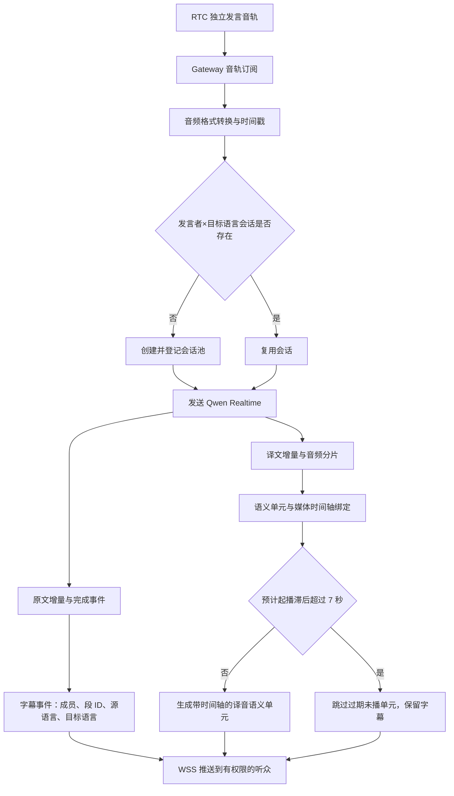
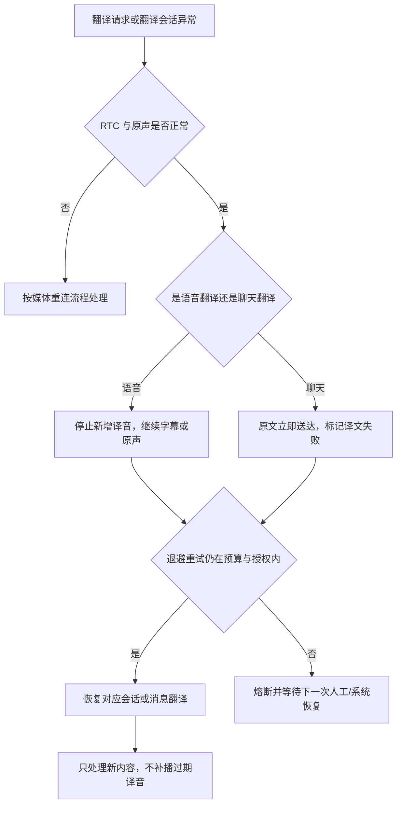
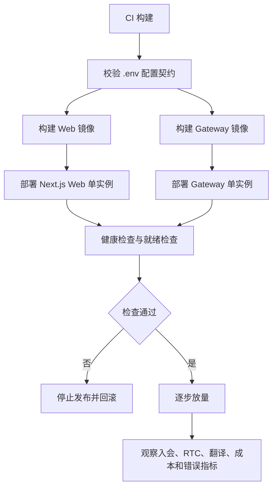

# 实时多语言转换会议室整体架构设计

## 1. 文档定位

本文根据以下文档制定：

| 依据 | 采用内容 |
| --- | --- |
| [实时多语言转换会议室产品设计](实时多语言转换会议室.md) | 产品范围、会议生命周期、角色权限、翻译频道、字幕与译音策略、数据保护和验收门槛 |
| [Next.js 全栈架构](../rules/next-全栈架构.md) | App Router、Feature-first、服务端 DAL/Service/Repository、环境变量和服务端边界 |
| [Next.js 第三方库清单](../rules/next-lib.md) | Next.js、React、Axios、`ws`、SWR、Supabase、Zod、RecordRTC、Vitest、Playwright 等固定工具 |

本文是实时多语言转换会议室的固定架构。代码必须按本文目录和依赖方向归位。产品中的“能力验证阶段”是发布前的技术门槛，不代表运行时保留多套实现。

## 2. 架构结论

系统采用“Next.js Web 应用 + 独立 Node.js 实时翻译网关 + RTC 媒体服务 + Qwen 实时翻译服务”的四个运行单元：

| 运行单元 | 固定职责 | 运行方式 |
| --- | --- | --- |
| Web App | 页面、登录、会议管理、入会审批、权限命令、聊天接口、字幕与译音播放控制 | Next.js App Router；部署为可水平扩展的 Web 服务 |
| Realtime Gateway | 长连接、媒体轨道路由、翻译会话、字幕事件、音频时间轴、重连和配额调度 | 独立 Node.js 进程；使用 `ws`，V1 单实例部署，禁止依赖 Next.js Route Handler 的长连接生命周期 |
| RTC Media Service | WebRTC 信令、SFU 媒体转发、音视频轨道、屏幕共享轨道和网络重连 | V1 固定使用 LiveKit Cloud；通过 `RtcProvider` 适配层接入，代码只保留 LiveKit 实现 |
| Data Services | 账号、会议元数据、成员权限、预约、持久化限流窗口和审计摘要 | Supabase Auth + PostgreSQL；服务端通过 Repository 访问，实时连接和模型会话状态不写入数据库 |



### 2.1 关键决策

| 决策 | 固定规则 |
| --- | --- |
| Next.js 长连接 | Next.js 只承载 HTTP、Server Action、页面和短请求；浏览器到翻译网关使用独立 WSS。 |
| 媒体与翻译分离 | WebRTC 音视频不经过 Next.js；网关只订阅需要翻译的独立音轨，不把混合音频直接送给模型。 |
| 状态权威 | 会议权限、成员状态、容量和命令裁决以服务端为准；客户端状态只能作为显示缓存。 |
| 内容生命周期 | V1 不持久化录音、视频、共享画面、字幕和聊天正文；网关只保留处理所需的内存缓冲，会议结束立即清理。 |
| 语言频道 | 按“发言者音轨 × 目标语言”复用翻译会话，同一目标语言的多个听众共享结果。 |
| 翻译降级 | 翻译不可用时保留 RTC、原声和聊天原文；不因 Qwen 或文本翻译故障结束会议。 |
| 配置管理 | Web 只从 `apps/web/.env.local` 经 `src/lib/env/server.ts`、`client.ts` 读取；Gateway 只从 `apps/realtime-gateway/.env.local` 经 `src/config/app-environment.ts` 读取；`packages/config` 只定义键名和校验契约，不读取真实值。 |

### 2.1.1 多路源语言统一翻译为个人目标语言

| 层次 | 固定规则 |
| --- | --- |
| 前端偏好 | `targetLanguage` 是单个语言值，不是源语言多选数组；界面标签为“将其他人的发言翻译成”。源语言识别作用于各成员独立音轨，不要求接收者勾选。 |
| 翻译路由 | 用户选择中文时，其他成员的日语、韩语、英语发言分别经“发言者音轨 × 中文”频道生成结果，再分发给该用户；不把多人的混合音频视为一个源语言。 |
| 同语言与本人 | 已确认中文发言直接保留原声，不生成重复中文译音；不向本人播放本人译音。自动识别未确定时保留原声。 |
| 输出方式 | “字幕＋原声”只改变字幕语言；“字幕＋译音”同时接收目标语言译音。跨语言原声仅在对应译音实际起播时压低，结束或失败恢复。 |
| 播放协调 | 每位接收者仍只有一条排序译音队列，多路源语言不并行混播；沿用过期、语义边界与故障降级规则。 |
| 切换与界面 | 新目标语言在安全段边界提交；旧字幕保留原语言标记，不回译历史；界面仍为简体中文。 |

### 2.2 部署阶段

| 阶段 | Web | Gateway | 共享基础设施 | 适用边界 |
| --- | --- | --- | --- | --- |
| V1 | 单实例 | 单实例 | LiveKit、Supabase、Qwen | 最多 10 人、60 分钟；先完成产品闭环和媒体/翻译验收 |
| 正式生产 | 多实例 | 多实例 | LiveKit、Supabase、Redis Pub/Sub、Redis 分布式锁、Qwen | 通过压测门禁后启用；保持协议和领域模型不变 |

## 3. 技术栈

| 能力 | 固定技术 | 使用位置 |
| --- | --- | --- |
| Web 框架 | Next.js App Router + React + TypeScript | `apps/web` |
| 服务端实时连接 | Node.js + `ws` | `apps/realtime-gateway` |
| HTTP 调用 | Axios | Web 服务端、网关到 RTC/翻译服务的适配器 |
| 客户端数据读取 | SWR | 页面读取会议元数据、账号状态和管理数据；实时状态使用 WSS 事件 |
| 身份认证 | Supabase Auth + `@supabase/ssr` | 邮箱验证码、Cookie 会话和跨设备所有权恢复 |
| 数据库 | Supabase PostgreSQL | 账号关联、会议元数据、权限、预约、审计摘要和限流状态 |
| 参数校验 | Zod | HTTP、Server Action、WSS 命令、环境配置和第三方事件 |
| 媒体 | WebRTC + LiveKit JS SDK/Server API | 浏览器媒体与 LiveKit Cloud SFU；服务端通过 `RtcProvider` 隔离 LiveKit SDK |
| 语音翻译协议 | Qwen `qwen3.8-livetranslate-flash-realtime` WebSocket | 网关到模型的音频、字幕和译音事件；模型 ID 由 Gateway 环境配置读取 |
| 聊天翻译协议 | Qwen 文本翻译 API + `ChatTranslationProvider` | 每条消息按接收者目标语言独立翻译；原文先广播，译文失败不影响原文 |
| 屏幕共享 | 浏览器 `getDisplayMedia` + RTC 共享轨道 | 浏览器采集并发布，网关不接收屏幕画面 |
| 本地录制 | V1 不启用 `recordrtc` | 不生成或上传会议录音；未来录制必须独立设计授权和存储 |
| 测试 | Vitest、Testing Library、Playwright | 单元、组件、浏览器流程和竞态测试 |
| 格式与检查 | TypeScript、ESLint、Prettier、`eslint-config-next` | CI 质量门禁 |

`@breezystack/lamejs`、二维码和对象存储库不进入 V1 运行依赖：V1 不录音、不导出内容、不需要支付二维码或文件存储。未来功能增加时必须重新定义数据生命周期和权限。

## 4. 项目目录

```text
project/
├── apps/
│   ├── web/                                      # Next.js Web 应用
│   │   ├── src/
│   │   │   ├── app/
│   │   │   │   ├── (site)/                       # 首页、即时会议和会议工作区
│   │   │   │   │   ├── page.tsx
│   │   │   │   │   ├── meeting/[meetingId]/
│   │   │   │   │   │   ├── page.tsx               # 会议主页面入口
│   │   │   │   │   │   ├── loading.tsx
│   │   │   │   │   │   └── error.tsx
│   │   │   │   │   └── meetings/page.tsx           # 预约会议管理
│   │   │   │   ├── (auth)/login/page.tsx          # 邮箱验证码登录
│   │   │   │   ├── (admin)/admin/                  # 运营和权限管理入口
│   │   │   │   ├── api/v1/                        # HTTP API
│   │   │   │   │   ├── meetings/route.ts          # 创建、查询、结束、预约
│   │   │   │   │   ├── meetings/[id]/join/route.ts
│   │   │   │   │   ├── meetings/[id]/commands/route.ts
│   │   │   │   │   └── users/me/route.ts
│   │   │   │   ├── api/webhooks/                   # 第三方回调；V1 不接收媒体内容
│   │   │   │   ├── layout.tsx
│   │   │   │   └── error.tsx
│   │   │   ├── features/
│   │   │   │   ├── authentication/
│   │   │   │   ├── meeting-lifecycle/             # 创建、预约、开始、结束和失效
│   │   │   │   ├── meeting-members/               # 申请、审批、重连、移出和主持权
│   │   │   │   ├── meeting-room/                  # 视频、字幕、译音、共享和聊天 UI
│   │   │   │   │   ├── components/BaseMeetingView.tsx # 会议页面公共能力与生命周期
│   │   │   │   │   ├── handlers/                  # 会议操作 Handler 组合
│   │   │   │   │   └── hooks/                     # RTC、WSS、字幕和播放协调
│   │   │   │   ├── translation-preferences/       # 目标语言、源语言、字幕和收听模式
│   │   │   │   └── account/                       # 所有者跨设备恢复和账号删除
│   │   │   ├── components/                        # 跨业务域基础 UI
│   │   │   │   ├── ui/
│   │   │   │   └── shared/
│   │   │   ├── hooks/                             # 跨 Feature 的纯客户端 Hook
│   │   │   ├── lib/
│   │   │   │   ├── auth/                          # Supabase 会话读取和权限基础能力
│   │   │   │   ├── db/                            # Supabase 服务端客户端
│   │   │   │   ├── env/                           # server.ts 与 client.ts
│   │   │   │   ├── http/                          # Axios 与 HTTP 错误标准化
│   │   │   │   ├── rtc/                           # 浏览器 RTC Provider Client 与令牌接口
│   │   │   │   ├── realtime/                      # WSS 客户端、事件版本和重连器
│   │   │   │   ├── playback/                      # TranslationPlaybackQueue；浏览器实际译音播放队列
│   │   │   │   ├── observability/                 # 日志、指标、错误上报
│   │   │   │   └── utils/
│   │   │   └── proxy.ts
│   │   ├── public/
│   │   ├── tests/
│   │   │   ├── unit/
│   │   │   ├── integration/
│   │   │   └── e2e/
│   │   ├── .env.example
│   │   ├── .env.local                            # 本地真实值，不提交
│   │   └── package.json
│   └── realtime-gateway/                          # 独立 Node.js 长连接服务
│       ├── src/
│       │   ├── main.ts                            # 进程入口、健康检查和优雅退出
│       │   ├── server.ts                          # ws Server、连接认证和心跳
│       │   ├── config/app-environment.ts          # 环境配置读取与校验
│       │   ├── auth/                              # WSS 短期票据验证
│       │   ├── meeting/                           # 房间状态、命令裁决和成员状态
│       │   │   ├── handlers/                      # MeetingCommandHandler、主持人和成员命令处理器
│       │   │   └── policies/                      # 权限、容量和状态版本策略
│       │   ├── data/                              # Gateway 数据访问层；使用 Supabase Service Role
│       │   │   ├── supabase-client.ts             # Service Role 客户端唯一创建处
│       │   │   └── repositories/                  # Meeting、Member、Permission、Usage Repository
│       │   ├── rtc/                               # RtcProvider、LiveKit 实现、音轨订阅和共享轨道状态
│       │   ├── translation/
│       │   │   ├── qwen-client.ts                 # Qwen WebSocket 适配
│       │   │   ├── session-pool.ts                # 发言者×目标语言会话池
│       │   │   ├── segment-router.ts              # 发言段、字幕和语言版本路由
│       │   │   ├── audio-timeline-policy.ts       # 计算时间轴、版本、过期和是否发送
│       │   │   └── output-strategies/              # 原声与译音输出策略
│       │   ├── chat-translation/                  # Qwen 文本翻译适配、限流和失败降级
│       │   ├── quota/                             # 并发、RPM、预算、退避和熔断
│       │   ├── protocol/                          # WSS 命令、事件、版本和 Zod Schema
│       │   ├── observability/                     # 结构化日志、指标和成本事件
│       │   └── shutdown/                          # 关闭会话、清理内存和释放 RTC
│       ├── tests/
│       │   ├── unit/
│       │   ├── integration/
│       │   └── fixtures/
│       ├── .env.example
│       ├── .env.local                            # 本地真实值，不提交
│       └── package.json
├── packages/
│   ├── contracts/                                # Web 与 Gateway 共享的协议类型和 Schema
│   │   ├── src/meeting.ts
│   │   ├── src/realtime-commands.ts
│   │   ├── src/realtime-events.ts
│   │   ├── src/translation.ts
│   │   └── src/index.ts
│   ├── domain/                                   # 纯 TypeScript 会议领域模型与规则
│   │   ├── src/meeting-state.ts
│   │   ├── src/member-state.ts
│   │   ├── src/permission-policy.ts
│   │   ├── src/segment-order.ts
│   │   └── src/index.ts
│   └── config/                                   # 配置键名和环境契约，不放真实值
│       └── src/index.ts
├── supabase/
│   ├── migrations/                               # 数据库迁移
│   ├── seed.sql                                  # 仅测试数据
│   └── config.toml
├── scripts/                                     # 迁移、检查、协议生成和本地启动
├── docs/                                        # ADR、协议和运行手册
├── .env.example                                 # 变量名和占位值
├── pnpm-workspace.yaml
├── package.json
└── tsconfig.json
```

环境文件固定归属如下：

| 文件 | 读取方 | 内容规则 |
| --- | --- | --- |
| `apps/web/.env.local` | Next.js `src/lib/env/server.ts`、`client.ts` | Supabase 公共配置、Web URL 和短期令牌配置；真实值不提交 |
| `apps/realtime-gateway/.env.local` | Gateway `src/config/app-environment.ts` | Supabase Service Role Key、LiveKit 服务端密钥、Qwen Key、Redis 配置；真实值不提交 |
| `packages/config` | Web 与 Gateway | 只放变量名、Zod Schema 和类型，不读取文件、不保存密钥 |
| 根目录 `.env.example` | 开发和 CI | 只放变量名与占位值，不能作为运行时真实配置 |

## 5. 业务域和依赖方向

```text
apps/web/app ───────> apps/web/features ───────> packages/domain
     │                         │                         ▲
     └──────> apps/web/lib ────┴──────> packages/contracts

apps/realtime-gateway ───────> packages/domain
             │                         ▲
             ├──────> packages/contracts
             ├──────> lib/db、lib/auth 的服务端契约
             └──────> RTC Provider、Qwen Provider、Quota Adapter
```

| 模块 | 允许依赖 | 禁止依赖 |
| --- | --- | --- |
| `apps/web/app` | Web Feature 公开入口、共享组件、Core | 业务 Service 实现、Gateway 内部目录 |
| `apps/web/features` | 自身目录、`packages/domain`、`packages/contracts`、`apps/web/lib` | 其他 Feature 内部文件、Gateway 进程代码 |
| `apps/web/lib` | 第三方 SDK、`packages/contracts`、基础工具 | 具体 Feature、页面和 Gateway 内部实现 |
| `apps/realtime-gateway` | `packages/domain`、`packages/contracts`、服务端适配器 | React、浏览器 DOM、Next.js 页面 |
| `packages/domain` | 纯 TypeScript | Next.js、React、Node API、数据库、Axios、RTC、Qwen |
| `packages/contracts` | TypeScript、Zod | 数据库、浏览器、第三方 SDK和业务实现 |

Feature 之间禁止直接依赖。Web 与 Gateway 只能通过 `packages/contracts` 共享协议；Gateway 与数据库之间通过 `apps/realtime-gateway/src/data/repositories` 访问会议状态，不能从 Web 进程共享可变房间内存。Gateway 使用 Supabase Service Role Key，所有写操作必须经过 Repository 的显式方法；Web 使用用户会话和 RLS，禁止把 Service Role Key 暴露给 Web。

React 页面通过 `BaseMeetingView` 组合公共生命周期和错误处理，通过 `meeting-room/handlers` 持有 `MeetingCommandHandler`、`MediaHandler`、`TranslationHandler`、`ChatHandler` 等专用 Handler；页面只负责布局和事件绑定。Gateway 的 Handler、Policy、Strategy 和 Adapter 通过接口注入，禁止在页面或主流程中堆叠第三方 SDK 分支。

## 6. 会议状态机

### 6.1 房间状态

| 状态 | 进入条件 | 允许操作 | 离开条件 |
| --- | --- | --- | --- |
| `SCHEDULED` | 创建预约成功 | 修改、取消、分享链接 | 开始、取消、超时失效 |
| `READY` | 即时房间创建成功或预约进入可开始窗口 | 所有者准备设备、分享、开始 | 开始、取消、链接失效 |
| `WAITING_HOST` | 访客申请且主持人未开始/未审批 | 取消申请、等待状态事件 | 审批、拒绝、房间结束、申请超时 |
| `LIVE` | 服务端确认开始且媒体就绪 | 所有会中操作 | 主持人结束、60 分钟、最后一人主动离开 |
| `EMPTY_GRACE` | 全部成员意外掉线 | 原身份重连、所有者恢复 | 有效成员恢复或 2 分钟结束 |
| `ENDED` | 正常结束、超时或无人宽限结束 | 查看结束原因、返回首页 | 不可重新开始 |
| `CANCELLED` | 所有者取消或预约失效 | 查看失效原因 | 不可恢复，只能新建 |

状态变更必须由服务端原子执行，命令带 `expectedVersion`；版本不匹配时返回 `STATE_CONFLICT`，客户端重新获取状态后再决定是否重试。

### 6.2 成员状态

```text
APPLYING → APPROVED → CONNECTING → ONLINE
    │          │           │          │
    └→ REJECTED └→ EXPIRED  └→ EXPIRED └→ DISCONNECTED_HOLD
                                      │
                                      ├→ RECONNECTED
                                      └→ REMOVED
```

| 成员状态 | 固定行为 |
| --- | --- |
| `APPLYING` | 不占容量；主持人审批或拒绝；同一身份按 30 秒限流。 |
| `APPROVED` | 占一个待连接名额；30 秒未建立连接即释放。 |
| `ONLINE` | 占在线名额，可订阅媒体、字幕、译音和聊天。 |
| `DISCONNECTED_HOLD` | 保留名额 60 秒；原连接令牌失效，恢复连接需使用同一成员会话。 |
| `REMOVED` | 本场禁止再次申请；服务端拒绝旧令牌和旧连接。 |
| `RECONNECTED` | 恢复原成员身份和语言偏好，不补发断线期间的字幕、聊天和译音。 |

## 7. 端到端核心流程

### 7.1 创建与开始



开始会议的数据库写入必须幂等；RTC 房间创建成功但 DB 状态写入失败时，执行补偿关闭或回收，不允许出现“用户已开始但服务端仍 READY”的双状态。

### 7.2 申请、审批和重复接管



审批、锁房、链接撤销、移出和结束都必须在服务端重新校验权限；客户端收到成功前不得改变本地权威状态。

### 7.3 翻译数据流



### 7.4 语言切换

语言切换使用“双频道准备、边界提交”策略：旧语言在新频道准备期间继续工作；新频道就绪且到达安全发言边界后才提交切换。失败或超时保留旧频道和旧队列，不截断当前发言。

### 7.5 翻译降级



## 8. Web App 设计

### 8.1 页面与 Feature

| 路由 | 页面职责 | 调用方式 |
| --- | --- | --- |
| `/` | 即时会议、预约会议、输入邀请链接 | Server Component 读取登录状态，Client Component 提交创建命令 |
| `/login` | 邮箱验证码登录 | Supabase Auth 客户端调用 |
| `/meeting/[meetingId]` | 准备页、等待页、会议页和结束页 | Server Component 获取最小会议 DTO，Client Component 建立 RTC/WSS |
| `/meetings` | 所有者的未开始预约管理 | Server Component DAL + Server Action |
| `/admin` | 正式生产阶段的运营观察、配额、错误与会议元数据 | V1 不实现；服务端权限检查；不读取内容正文 |

### 8.2 客户端状态

| 状态 | 存储位置 | 规则 |
| --- | --- | --- |
| 会议元数据 | SWR Cache | 只缓存房间名、状态、人数和时间；WSS 事件触发失效或更新。 |
| WSS 连接状态 | `features/meeting-room/hooks` | 管理连接、心跳、指数退避和状态快照；不自行裁决权限。 |
| RTC 媒体状态 | `lib/rtc` + Feature Hook | 管理本端设备、轨道和播放；不把 MediaStream 放入 SWR 或服务端状态。 |
| 字幕 | 会议页内存 Store | 只保存本次会话已接收内容，按上限淘汰；离会立即清理。 |
| 聊天 | 会议页内存 Store | 不写入浏览器持久化存储；发送使用幂等 ID。 |
| 语言与收听设置 | 页面会话状态 | 切换由 Gateway 确认后才更新权威语言版本。 |

### 8.3 事件处理

所有 WSS 事件必须包含 `protocolVersion`、`connectionEpoch`、`meetingId`、`memberId`、`eventId`、`serverSequence` 和 `occurredAt`；`serverSequence` 只在同一 `connectionEpoch` 内去重和排序，重连建立新代次并重置序号。浏览器刷新后只获取当前快照，不补发历史字幕和聊天。

## 9. Realtime Gateway 设计

### 9.1 进程与连接

| 组件 | 职责 |
| --- | --- |
| `WsServer` | 校验 Origin、升级连接、心跳、最大帧大小和优雅关闭 |
| `GatewayAuthenticator` | 验证 Web App 签发的短期 Gateway Token；确认会议、成员、权限、令牌版本和处理告知同意状态 |
| `MeetingRegistry` | 管理本进程的连接索引；不作为跨实例权威状态 |
| `CommandDispatcher` | 统一接收 HTTP 转发和 WSS 命令，执行 Zod 校验、幂等、权限和状态版本校验 |
| `MeetingCommandHandler` | 按主持人、成员和会议结束职责分派命令；HTTP/WSS 共用同一处理器 |
| `RtcAdapter` | 申请 LiveKit Token、订阅发言音轨、发布/撤销共享轨道状态 |
| `TranslationOrchestrator` | 创建、复用、关闭翻译会话和处理模型事件 |
| `AudioTimelinePolicy` | 计算语义单元时间轴、语言版本、过期和是否发送；不负责浏览器播放 |
| `QuotaGuard` | 会话、请求、预算和连接的限额、退避、熔断 |
| `EventPublisher` | 生成事件序号并向授权成员广播最小事件 |

V1 网关使用单实例内存管理实时连接、模型会话和短周期配额计数，Supabase 记录会议权威状态、持久化限流窗口和审计摘要；Gateway Repository 负责全部数据库读写。正式生产多实例只使用本节 9.3 规定的 Redis Pub/Sub 和 Redis 分布式锁，不临时增加其他状态方案。

### 9.2 WSS 命令

| 命令 | 发起方 | 服务端行为 |
| --- | --- | --- |
| `meeting.join` | 已批准成员 | 校验短期凭证、容量和成员状态，转为 ONLINE |
| `meeting.takeover` | 同身份新端 | 原子撤销旧连接并发送 `connection.replaced` |
| `member.approve` | 主持人 | 校验状态版本，批准并预留 30 秒名额 |
| `member.remove` | 主持人 | 撤销媒体、翻译、聊天和重连权限 |
| `host.transfer` | 主持人 | 原子转移主持权，通知全体 |
| `room.lock` / `room.unlock` | 主持人 | 变更申请入口，处理待审批和未连接批准 |
| `screen.share.reserve` | 成员 | 预留唯一共享名额，30 秒后过期 |
| `screen.share.publish` | 成员 | 再次校验后发布共享状态 |
| `caption.subscribe` | 成员 | 仅订阅本人目标语言和已授权发言段 |
| `translation.switch.prepare` | 成员 | 准备新语言频道，不改变旧频道 |
| `translation.switch.commit` | 成员 | 在安全边界提交语言版本 |
| `chat.send` | 成员 | 校验处理告知同意、幂等写入内存消息并广播原文，触发按接收者语言的文本翻译 |
| `meeting.leave` / `meeting.end` | 成员/主持人 | 区分主动离开与结束会议，执行清理 |

### 9.3 V1 单实例与正式生产多实例

V1 固定部署一个 Realtime Gateway 实例，单实例内存管理连接、音轨订阅和 Qwen 会话；Supabase 只保存会议权威状态。V1 不部署多 Gateway，不引入跨实例广播和分布式会话锁。

正式生产扩展到多实例时，固定使用 Redis Pub/Sub 做事件广播、Redis 分布式锁管理翻译会话所有权，并继续以数据库状态版本裁决成员和会议状态。

| 问题 | 处理方式 |
| --- | --- |
| 连接落到不同实例 | 令牌和成员版本由数据库校验；新连接接管时递增 `connectionVersion`，旧实例收到版本变化后关闭旧连接。 |
| 事件广播 | Redis Pub/Sub 广播到各实例本地连接；客户端按 `connectionEpoch + serverSequence` 去重。 |
| 翻译会话重复 | Redis 分布式锁按 `meetingId + speakerTrackId + targetLanguage` 获取会话所有权；失去锁的实例关闭本地模型连接。 |
| 实例退出 | 先停止接收新连接，向成员发送维护事件，关闭 Qwen 会话和 RTC 订阅，最后关闭 WSS。 |
| 状态恢复 | 网关重启不恢复字幕和聊天历史；成员重新建立 WSS 和 RTC，当前快照由 Web/数据库返回。 |

## 10. RTC 适配层

固定使用 LiveKit。Web 和 Gateway 不直接依赖 LiveKit SDK 的业务细节，统一通过 `RtcProvider` 接口访问：

```ts
interface RtcProvider {
  createRoom(input: CreateRtcRoomInput): Promise<RtcRoom>
  issueMemberToken(input: IssueMemberTokenInput): Promise<RtcToken>
  subscribeAudioTrack(input: SubscribeAudioTrackInput): Promise<AudioTrackSubscription>
  authorizeScreenTrack(input: AuthorizeScreenTrackInput): Promise<ScreenShareAuthorization>
  updateMemberPermissions(input: UpdateMemberPermissionsInput): Promise<void>
  disconnectMember(input: DisconnectMemberInput): Promise<void>
  revokeTrack(input: RevokeTrackInput): Promise<void>
  closeRoom(input: CloseRtcRoomInput): Promise<void>
}
```

必须验证的 RTC 能力：

| 能力 | 验收要求 |
| --- | --- |
| 独立音轨 | 网关能按成员身份订阅单独音轨，不依赖混音说话人识别。 |
| 屏幕共享 | 浏览器发布共享轨道；服务端保证单房间单共享者；停止、断线和撤权立即释放。 |
| 令牌权限 | 令牌区分发布、订阅、共享和主持控制；权限撤销由 Gateway 更新成员权限并调用 LiveKit disconnect/remove participant，令牌过期由 LiveKit 校验，接管立即关闭旧连接。 |
| 重连 | 断线 60 秒内能恢复原成员和媒体；不补发媒体、字幕和聊天历史。 |
| 浏览器支持 | 桌面 Chrome、Edge 当前稳定版分别验证摄像头、麦克风、屏幕选择和自动播放限制。 |
| 容量 | 10 人、60 分钟、最多 30 个稳定跨语言翻译组合下，媒体稳定且不阻塞网关。 |

## 11. 翻译网关与模型适配

### 11.1 会话池

```text
TranslationSessionKey = meetingId + speakerTrackId + targetLanguage
```

| 会话行为 | 固定规则 |
| --- | --- |
| 创建 | 有听众订阅且目标语言不同于确认源语言时创建；集中排队并受 RPM/并发限制。字幕与译音共享同一翻译会话，输出模式由客户端决定。 |
| 复用 | 同一发言者和目标语言共享文本与译音结果；不为每个听众创建模型会话。 |
| 输入 | RTC 音频转换为模型要求的 PCM 格式，带会议、成员和发言段标识。 |
| 输出 | 原文、译文、音频分片分别解析；模型事件不得直接暴露浏览器。 |
| 关闭 | 无目标听众、成员离开、权限撤销、会议结束或熔断时关闭；关闭后丢弃未播放译音。 |
| 轮换 | 长连接达到实测会话上限时只在发言边界轮换，保留成员和段序映射。 |

### 11.2 音频播放协调

Gateway 输出统一的语义单元：

| 字段 | 含义 |
| --- | --- |
| `segmentId` | 发言段或语义单元唯一标识 |
| `speakerMemberId` | 会议成员 ID，不使用模型 `speaker_id` 作为权限身份 |
| `sourceLanguage` | 自动识别或已确认的源语言 |
| `targetLanguage` | 接收者当前目标语言 |
| `sourceStartAt` / `sourceEndAt` | 服务端媒体时间轴 |
| `textDelta` / `textFinal` | 字幕增量与定稿 |
| `audioDelta` | 译音分片，附带顺序和版本 |
| `translationVersion` | 语言切换版本，防止旧译音串入新频道 |
| `status` | `TRANSCRIBING`、`TRANSLATING`、`READY`、`SKIPPED`、`FAILED`；浏览器播放状态通过独立回执上报，不由 Gateway 推断 `PLAYING` |

客户端只播放当前授权、当前语言版本且未过期的语义单元；服务端负责排序，浏览器不能用事件到达顺序代替时间轴顺序。

## 12. 数据模型与存储

V1 只持久化管理会议所需的元数据，不持久化内容正文。

| 表 | 持久化字段 | 生命周期 |
| --- | --- | --- |
| `profiles` | `id`、认证关联、邮箱摘要、创建时间 | 账号存在期间 |
| `meetings` | `id`、`owner_id`、名称、状态、预约时间、时区、开始/结束时间、状态版本、链接版本、创建时间 | 结束/取消/失效后最多 24 小时 |
| `meeting_members` | `meeting_id`、成员 ID、账号/访客标识摘要、角色、成员状态、语言偏好、加入/离开时间、连接版本 | 会议结束后最多 24 小时 |
| `meeting_permissions` | 锁房、共享权限、自行解除静音、主持权版本 | 会议结束后最多 24 小时 |
| `meeting_usage` | RTC 时长、模型输入/文本/音频用量、失败数、成本估算 | 保留聚合指标，不含内容 |
| `audit_events` | 操作类型、操作者 ID、会议 ID、结果、时间和版本 | 保留不含内容的安全审计摘要 |
| `rate_limits` | 身份摘要、房间摘要、窗口和计数 | 窗口过期自动清理 |

字幕、译文、聊天正文、原始音频、译音和屏幕画面不进入 PostgreSQL、SWR 持久缓存、浏览器 localStorage 或对象存储。

## 13. API 与协议边界

### 13.1 HTTP API

| API | 方法 | 规则 |
| --- | --- | --- |
| `/api/v1/meetings` | `POST` | 登录后创建即时或预约会议；Zod 校验名称、时间和时区。 |
| `/api/v1/meetings/:id` | `GET` | 返回最小会议 DTO；所有者或有效入会身份才能读取。 |
| `/api/v1/meetings/:id/start` | `POST` | 所有者开始会议；服务端原子校验时间窗口并获取 RTC 资源。 |
| `/api/v1/meetings/:id/join` | `POST` | 访客提交申请或登录成员恢复；必须携带处理告知同意和同意版本，返回等待状态，不直接给媒体权限。 |
| `/api/v1/meetings/:id/rtc-token` | `POST` | 已批准成员获取短期 RTC Token；不返回 Qwen 凭证。 |
| `/api/v1/meetings/:id/gateway-token` | `POST` | 已批准且已确认处理告知的成员获取短期 Gateway Token；绑定会议、成员、权限版本、同意版本和过期时间。 |
| `/api/v1/meetings/:id/commands` | `POST` | 预约、锁房、移交、结束等短命令；重复命令幂等。 |
| `/api/v1/meetings/:id/schedule` | `PATCH` | 所有者修改未开始预约；不允许修改已开始会议。 |
| `/api/v1/meetings/:id/cancel` | `POST` | 所有者取消未开始会议，撤销邀请版本。 |
| `/api/v1/meetings/:id/owner-restore` | `POST` | 新鲜登录验证后恢复所有者会话，不读取会中内容。 |
| `/api/v1/account` | `DELETE` | 邮箱验证码和二次确认通过后删除账号及其未开始会议、成员关联和可识别账号摘要；进行中的会议先按结束流程处理。 |

HTTP 是所有短请求和所有者恢复的唯一入口；WSS 不处理邮箱验证码、Supabase Cookie 验证或所有者恢复。`/commands` 只负责把短命令转发给 Gateway 的 `CommandDispatcher`，不在 Next.js 和 Gateway 各实现一套业务规则。

### 13.2 WSS 事件

| 事件方向 | 内容 |
| --- | --- |
| Client → Gateway | 命令、心跳、订阅目标语言、RTC 轨道状态和消息幂等 ID |
| Gateway → Client | 成员状态、主持权限、字幕、译音分片、聊天原文/译文、共享状态、降级和错误 |
| 禁止发送 | Qwen API Key、数据库凭证、内部堆栈、未授权成员的语言频道、其他会议事件 |

所有消息使用 `packages/contracts` 的 Zod Schema 校验；未知事件版本拒绝处理并发送可升级错误，不静默解析。

浏览器收到译音分片后由 `TranslationPlaybackQueue` 实际排队、处理自动播放限制、压低原声、起播、完成和过期清理；Gateway 只输出 `AudioTimelinePolicy` 计算后的语义单元，不维护浏览器播放队列。

## 14. 安全设计

| 风险 | 控制措施 |
| --- | --- |
| 邀请链接泄漏 | 链接只包含不可预测会议标识和链接版本，不包含主持凭证；撤销后旧版本失效。 |
| 匿名访客冒用 | 访客身份仅用于本场，服务端记录匿名摘要、申请限流和移出状态；不宣称匿名身份不可绕过。 |
| Qwen 凭证泄漏 | Qwen Key 只在 Gateway 服务端环境中读取；浏览器只得到短期 RTC/Gateway Token。 |
| 越权订阅 | 每次订阅验证会议、成员、目标语言和权限版本；事件只发给授权成员。 |
| 重放命令 | Token 有效期、命令幂等 ID、状态版本和连接版本共同校验。 |
| XSS/聊天链接 | 聊天按纯文本渲染，链接仅允许 HTTP/HTTPS，隔离新页打开，不执行 HTML。 |
| 资源滥用 | 创建、验证码、入会、WSS、模型会话、聊天和共享分别限流；预算熔断保留原声降级。 |
| 日志泄漏 | 只记录 ID 摘要、错误码、状态、耗时、用量和成本；不记录音频、字幕、聊天正文、邀请凭证和 Key。 |
| 第三方配置 | `.env.local` 等环境文件统一读取；`NEXT_PUBLIC_` 仅放可公开配置；真实文件不提交。 |

## 15. 可观测性与成本

### 15.1 指标

| 指标组 | 指标 |
| --- | --- |
| 入会 | 创建成功率、申请到审批时延、批准到连接成功率、重复接管成功率 |
| RTC | 首帧时间、音视频重连率、共享成功率、断线恢复率、媒体异常数 |
| 字幕 | 原文首字延迟、译文首字延迟、字幕定稿率、发言人归属错误数 |
| 译音 | 语义单元起播率、完整播放率、预计起播滞后分位数、过期跳过数、译音失败数 |
| 语言 | 切换成功率、切换失败率、切换期间旧频道可用率、源语言纠正生效率 |
| 聊天 | 原文送达率、翻译成功率、翻译延迟、重试重复率 |
| 成本 | 房间小时 RTC 成本、模型输入/文本/音频成本、聊天翻译成本、单房间预算消耗 |
| 安全 | 越权拒绝、过期 Token、旧链接、限流、熔断和接管事件 |

### 15.2 Trace 与日志

所有链路使用 `traceId`、`meetingId` 摘要、`memberId` 摘要、`segmentId` 和 `translationVersion` 关联。日志分为 Web、Gateway、RTC Adapter、Qwen Adapter 四类；生产日志不含正文。成本事件在完成或失败时上报，包含在途请求回收结果。

## 16. 测试策略

| 测试层 | 测试内容 | 工具/位置 |
| --- | --- | --- |
| Domain 单元 | 房间状态机、成员状态、权限、容量、排序和语言版本 | Vitest，`packages/domain/tests` |
| Contract 单元 | WSS 命令/事件 Zod Schema、版本兼容和未知事件 | Vitest，`packages/contracts/tests` |
| Web 单元 | 表单、页面状态、字幕、聊天、主持控制和降级展示 | Vitest + Testing Library |
| Gateway 单元 | 会话池、时间轴、队列、预算、退避和幂等 | Vitest，禁止连接真实 Qwen |
| Gateway 集成 | V1 模拟 RTC、Qwen 事件、乱序、断线和限流；正式生产增加多实例竞态 | Vitest/Node Mock |
| Web-Gateway 集成 | WSS 鉴权、快照、事件顺序、接管和重连 | Node WebSocket 测试客户端 |
| 浏览器 E2E | 创建、预约、审批、10 人入会、共享、聊天、切换、离开和结束 | Playwright |
| 音频 PoC | 中英日韩、长句、同语言、重叠、回声、译音排队 | 预先审定语料和真实浏览器 |
| RTC PoC | 10 人、60 分钟、最多 30 个稳定跨语言组合、断线恢复和屏幕共享 | 目标 Chrome/Edge + LiveKit |
| 数据保护 | 结束清理、账号删除、日志脱敏、过期链接、旧 Token 和被移出身份 | 集成测试与数据库检查 |

## 17. 部署与运行



| 运行要求 | 固定规则 |
| --- | --- |
| Web 扩展 | Web 服务无房间可变内存依赖；正式生产可独立水平扩展。 |
| Gateway 扩展 | V1 固定单实例；正式生产扩展时启用 Redis Pub/Sub 和 Redis 分布式锁后再水平扩展。 |
| 健康检查 | Web 检查数据库和认证配置；Gateway 分离存活检查与就绪检查，Qwen 暂时不可用不代表进程存活失败，但会触发翻译降级告警。 |
| 优雅退出 | Gateway 停止接新连接，通知维护，关闭模型会话、RTC 订阅和本地内存，再退出。 |
| 数据清理 | 会议结束事件触发内存清理；定时任务清除 24 小时后的会议元数据、权限状态和限流记录。 |
| 发布顺序 | 先部署兼容协议的 Gateway，再部署 Web；协议破坏性变更使用版本号并完成灰度。 |

## 18. 实施顺序

| 阶段 | 交付内容 | 完成条件 |
| --- | --- | --- |
| 1. RTC/模型 PoC | 验证固定的 LiveKit、独立音轨、屏幕共享、10 人媒体、Qwen 音频格式和长连接 | 音频时间轴、回声隔离、重连和目标浏览器通过 |
| 2. 领域与协议 | 完成状态机、权限、容量、成员、WSS Schema 和幂等命令 | Domain 与 Contract 单测通过，竞态无越权 |
| 3. Web 会议闭环 | 登录、即时/预约、设备准备、申请、审批、会议页和结束 | Playwright 主流程通过 |
| 4. Gateway 翻译 | 会话池、字幕、译音、语言切换、队列、降级和预算 | 30 个稳定跨语言组合、长句和乱序测试通过 |
| 5. 协作能力 | 屏幕共享、聊天原文与文本翻译、所有者恢复、账号删除 | 权限、内容清理、同意校验和文本翻译门槛通过 |
| 6. V1 发布门禁 | 弱网、60 分钟、费用、日志脱敏、10 人单 Gateway 全链路压测 | 产品文档第 11 节所有上线门槛通过 |
| 7. 正式生产扩展 | Redis Pub/Sub、Redis 分布式锁、Gateway 多实例和运营后台 | 多实例竞态、故障转移、成本和权限验收通过 |

## 19. 架构边界总结

| 问题 | 唯一答案 |
| --- | --- |
| 页面放哪里 | `apps/web/src/app`，页面业务放对应 Feature |
| 会议业务规则放哪里 | `packages/domain`，纯 TypeScript |
| 数据库和权限查询放哪里 | `apps/web` 服务端 Feature 的 DAL/Service/Repository |
| 长连接放哪里 | `apps/realtime-gateway`，使用 `ws` |
| WebRTC 媒体放哪里 | 浏览器与独立 RTC 服务；通过 `RtcProvider` 适配 |
| Qwen API 放哪里 | Gateway 的 `qwen-client.ts`，只读取服务端环境配置 |
| 字幕和聊天是否入库 | V1 不入库，只保留当前会话内存内容 |
| 翻译按什么复用 | 发言者音轨 × 目标语言；同语言听众共享结果 |
| 谁裁决权限和人数 | 服务端数据库状态版本与命令处理器 |
| 环境配置放哪里 | Node/Next 使用 `.env.local` 等环境文件；所有代码经统一配置入口读取 |
